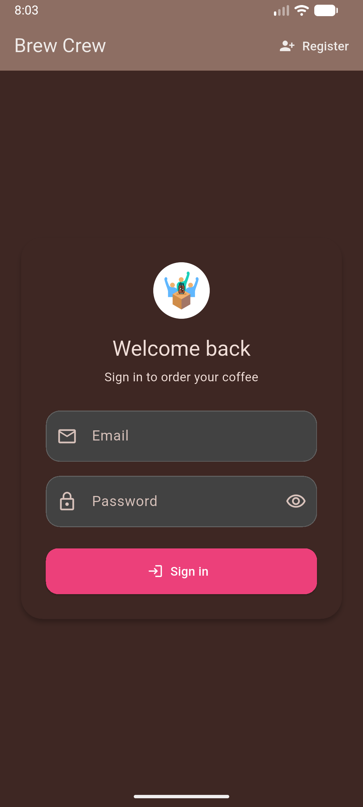
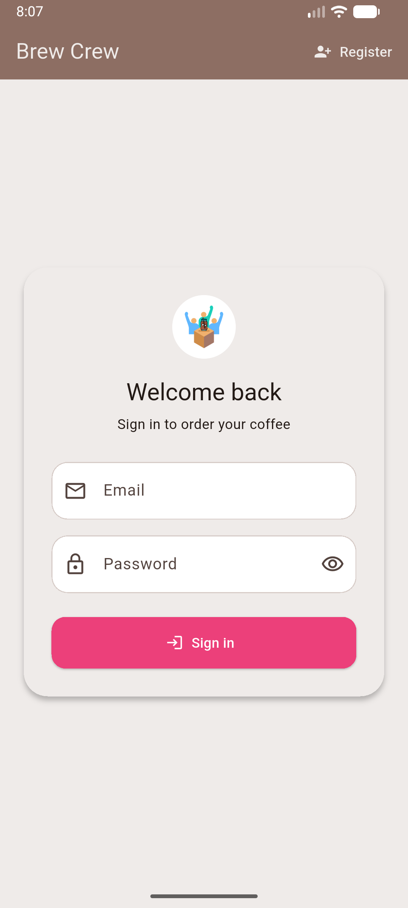
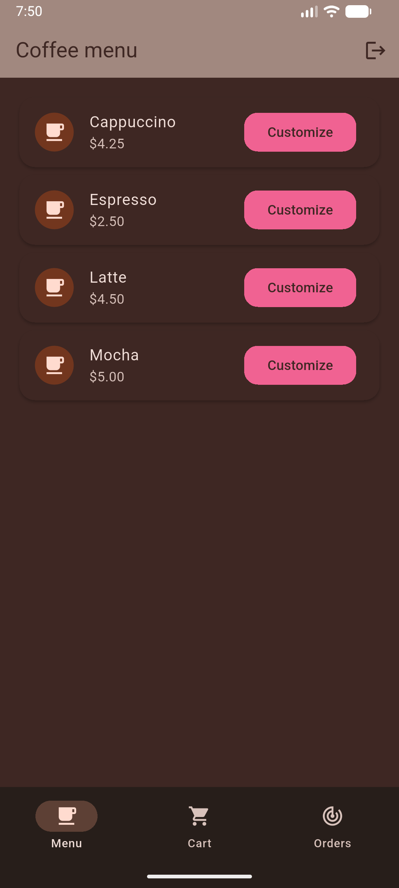
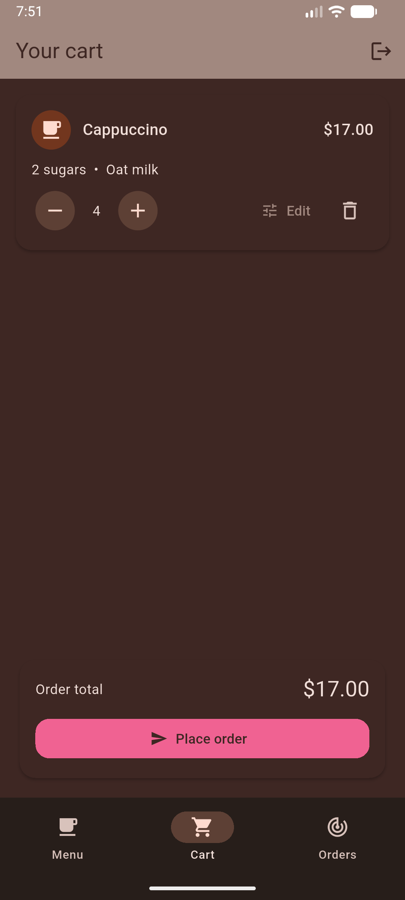
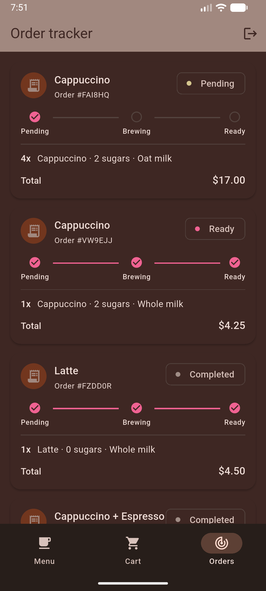
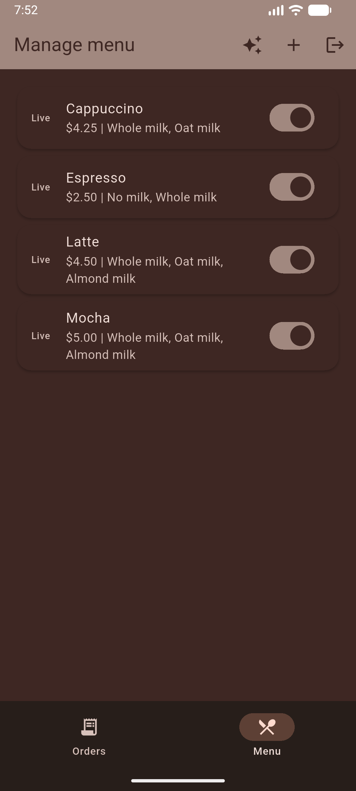
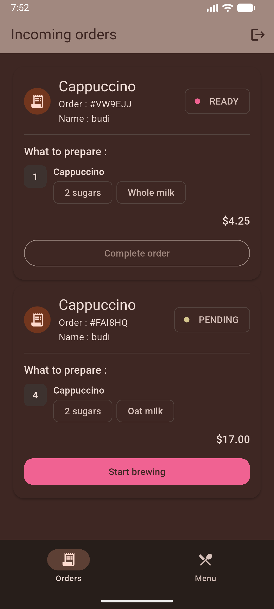

# Brew Crew

Brew Crew is a Flutter coffee-ordering app backed by Firebase Authentication and Cloud Firestore. Customers browse a live menu, customize drinks, place orders, and track status. Baristas manage menu availability and update incoming orders.

## Screenshots

<details>
<summary><b>Click to view UI Previews</b></summary>
<br>

| Login Dark | Login Light |
| :---: | :---: |
|  |  |

| Customer Menu | Customer Cart | Customer Order |
| :---: | :---: | :---: |
|  |  |  |

| Barista Menu | Barista Order |
| :---: | :---: |
|  |  |

</details>


## Features

- Email/password registration and sign-in
- Customer and barista experiences selected from the Firestore user role
- Live menu updates from Firestore
- Drink customization for quantity, sugar, and milk
- Local cart that is written to Firestore when the customer places an order
- Live customer order tracking and barista order queue
- Menu item creation and availability controls for baristas
- Brown-and-pink Material theme with light and dark modes

## User Guide

### Customer

1. Register with an email address and password. New registrations are assigned the `customer` role.
2. Browse the Menu tab and choose **Customize** on a drink.
3. Select sugar, milk, and quantity, then add the drink to the cart.
4. In Your cart, adjust quantity, edit customizations, or remove items.
5. Choose **Place order** to submit the cart.
6. Follow progress in Orders: Pending, Brewing, and Ready. Completed orders remain visible in the order list.

### Barista

1. Sign in with an account whose Firestore user document has `role: "barista"`.
2. In Orders, review the customer, order number, drink details, customizations, and total.
3. Advance an order from Pending to Brewing, then Ready, and finally Completed.
4. Open Menu to add menu items or toggle whether items are visible to customers.
5. Use the sparkle icon in the app bar to load or refresh the four example menu items.

## Developer Setup

<details>
<summary><b>Requirements</b></summary>
<br>

### Requirements

- Flutter SDK compatible with the Dart constraint in `pubspec.yaml` (`^3.12.2`)
- Android Studio or another Android SDK installation for Android builds
- A Firebase project with Authentication and Cloud Firestore enabled

From the repository root:

```sh
flutter pub get
flutter analyze
flutter test
flutter run
```

Build an Android APK with:

```sh
flutter build apk --release
```

The current Android release Gradle configuration uses the debug signing key. Configure a proper release keystore before distributing a production build.

</details>

</br>

<details>
<summary><b>Firebase Project Setup</b></summary>
<br>

## Firebase Project Setup

### 1. Create and configure Firebase

1. Create a project in the Firebase Console.
2. Add an Android app with package name `crew.brew` (the `applicationId` in `android/app/build.gradle.kts`).
3. Download `google-services.json` and place it at `android/app/google-services.json`.
4. In **Authentication → Sign-in method**, enable **Email/Password**.
5. In **Firestore Database**, create a database in the region appropriate for your users. For normal use, start in production mode and apply the rules below before using the app.

The Android Gradle file already applies the Google Services plugin, and `main.dart` initializes Firebase with `Firebase.initializeApp()`. Do not commit service-account keys or other server credentials. The Android client configuration file identifies the Firebase project; it is not a substitute for Firestore security rules.

### 2. Apply Firestore security rules

The repository includes [firestore.rules](firestore.rules). These rules allow customers to read their own profile and orders, create their own customer profile and pending orders, and prevent users from changing their own role. Baristas can manage menu items and update order status.

There is currently no `firebase.json` in this repository, so `firebase deploy --only firestore:rules` will not work until Firebase CLI configuration is added. To apply the rules without CLI configuration:

1. Open Firebase Console → **Firestore Database → Rules**.
2. Replace the editor contents with the contents of `firestore.rules`.
3. Publish the rules.

Do not run the app against production data with permissive test-mode rules. The menu management screen requires the signed-in user to have the barista role.

### 3. Firestore collections

Collections are created automatically when the app first writes documents. Firestore does not require pre-creating empty collections.

#### `users/{uid}`

The document ID must be the Firebase Authentication UID.

```json
{
	"name": "Jordan",
	"email": "jordan@example.com",
	"role": "customer",
	"defaultSugars": 1,
	"defaultMilk": "Oat milk"
}
```

Roles are `customer` and `barista`. Registration creates a customer profile automatically. Default preference fields are used to preselect drink options where the menu supports them.

#### `menu/{itemId}`

Menu documents can be created by a barista from the Menu screen. The sparkle action inserts or refreshes these example documents:

```json
{
	"itemName": "Latte",
	"basePrice": 4.5,
	"imageUrl": "",
	"availableSugars": [0, 1, 2, 3, 4],
	"milkOptions": ["Whole milk", "Oat milk", "Almond milk"],
	"isAvailable": true
}
```

The example menu also includes Espresso, Cappuccino, and Mocha. Customers only receive items where `isAvailable` is `true`. The current UI does not display `imageUrl`; it is reserved for menu imagery.

#### `orders/{orderId}`

The customer cart remains local until checkout. Placing an order creates a Firestore document similar to:

```json
{
	"orderNumber": "A1B2C3",
	"orderName": "Latte + Mocha",
	"userId": "firebase-auth-uid",
	"customerName": "Jordan",
	"timestamp": "Firestore server timestamp",
	"status": "pending",
	"totalPrice": 9.5,
	"items": [
		{
			"menuItemId": "latte",
			"itemName": "Latte",
			"quantity": 1,
			"unitPrice": 4.5,
			"sugars": 1,
			"milk": "Oat milk"
		}
	]
}
```

Valid order statuses are `pending`, `brewing`, `ready`, and `completed`. Order items keep a snapshot of the selected name, price, and customizations so later menu edits do not rewrite old orders.

### 4. Create a barista account

Do not let users choose their own role during public registration.

1. In Firebase Console, open **Authentication → Users → Add user** and create the barista email/password account.
2. Copy its UID.
3. In **Firestore Database → Data**, create a document in `users` with the document ID set to that UID.
4. Add the fields below (use string, string, integer, and string types respectively):

```text
name: "Sam"
email: "sam@example.com"
role: "barista"
defaultSugars: 0
defaultMilk: "Whole milk"
```

The account can then sign in through the regular login screen. The app reads `users/{uid}.role` and routes baristas to the order/menu dashboard.

### 5. Load and manage the menu

1. Sign in as a barista.
2. Open the Menu tab.
3. Tap the sparkle icon to seed the example menu, or tap the add icon to create an item.
4. Toggle an item off to hide it from customers without deleting its historical order data.

Seeding uses stable document IDs (`espresso`, `latte`, `cappuccino`, and `mocha`) and merges those fields into existing documents. It is safe to use while developing, but it will refresh the seeded items' example values.

## Firestore Indexes

Order streams filter by user/status and sort by timestamp. If Firestore reports that a composite index is required, open the index-creation link included in the Firebase error and create the suggested index for the project. Indexes are project-specific and are not currently managed by a checked-in `firestore.indexes.json`.

</details>

</br>

<details>
<summary><b>Project Structure</b></summary>
<br>

## Project Structure

```text
lib/
	main.dart                    Firebase and app theme setup
	models/                      User, menu item, and order models
	providers/cart_provider.dart Local customer cart
	screens/authenticate/        Sign-in and registration
	screens/customer/            Customer menu, cart, and order tracker
	screens/barista/             Order queue and menu management
	services/                    Firebase Auth and Firestore access
	shared/                      Shared form styling and loading UI
firestore.rules                Firestore authorization rules
```
</details>

## Troubleshooting

<details>
<summary><b>Click to view possible troubleshoting steps to try</b></summary>
<br>

- **Firebase app/configuration error:** Confirm `android/app/google-services.json` belongs to the Firebase project and that its Android app package is `crew.brew`.
- **Permission denied:** Confirm Authentication and Firestore are enabled, publish `firestore.rules`, and ensure the barista has a matching `users/{uid}` document with role `barista`.
- **Customer sees an empty menu:** Sign in as a barista and seed the example menu, or add menu documents with the schema above and `isAvailable: true`.
- **Query requires an index:** Create the suggested Firestore composite index from the error link.
- **Password autofill is unavailable:** Enable an Android Autofill service/password manager in device settings and save credentials with that service.

### Add google-services.json to Repository Secret

- Copy all the google-sevices.json to base64 with this command
```pwsh
# Windows
[Convert]::ToBase64String([System.IO.File]::ReadAllBytes("$(pwd)/android/app/google-services.json"))
```

```bash
# Universal (Works on both macOS and Linux without line breaks)
openssl base64 -A -in android/app/google-services.json
```

- Go to https://github.com/get543/brew_crew/settings/secrets/actions or something similar
- Add New Repository Secret
- Name : FIREBASE_JSON_BASE64 
- Secret : (text you copied from the command above)
</details>